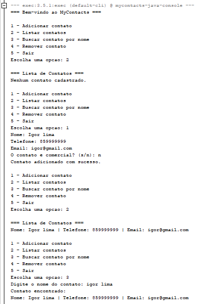
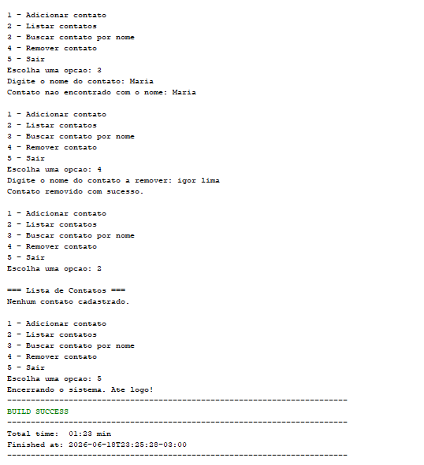

# MyContacts — segunda entrega

Agenda de contatos em Java, com interface JavaFX em FXML, versão console e persistência SQLite compartilhada. Evolui a primeira entrega mantendo os pacotes `br.com.igor.mycontacts`, os modelos `Contato` e `ContatoComercial`, a agenda, as exceções e o utilitário `ValidadorEmail`.

## Requisitos

- JDK **17 ou superior**, com `JAVA_HOME` apontando para o JDK.
- Maven **3.9 ou superior**, disponível no `PATH`.
- Conexão com a internet na primeira compilação para baixar as dependências do Maven Central.
- Sessão gráfica para executar JavaFX e os testes opcionais de interface. Os demais testes não abrem janelas.

O `pom.xml` fixa a compilação com `--release 17`, JavaFX **17.0.21**, SQLite JDBC **3.53.4.0**, JUnit Jupiter **5.14.2**, Compiler **3.14.1**, Surefire **3.5.4**, JavaFX Maven Plugin **0.0.8** e Exec Maven Plugin **3.5.0**. Não é necessário instalar separadamente o SDK JavaFX nem um servidor de banco.

## Executar

Execute os comandos na pasta que contém o `pom.xml`.

```shell
# Interface gráfica
mvn compile javafx:run

# Console (classe Main)
mvn compile exec:java

# Testes de regras, DAO e Generics
mvn test

# Compilar, testar e gerar o JAR em target/
mvn clean verify

# Também carregar as telas e testar eventos e confirmações em uma sessão gráfica
mvn -Pverificar-interface test
```

O perfil gráfico abre e fecha janelas automaticamente. Ele gera imagens das telas em `target/verificacao-ui/` e inclui os testes normais. O JAR comum do Maven não contém as dependências; utilize os comandos acima para iniciar a aplicação.

## Funcionalidades e regras

- Tabela com ID, nome, telefone, e-mail, tipo e empresa; busca por parte do nome, botão Limpar e atualização da lista.
- Cadastro e edição em formulário modal; seleção entre contato comum e comercial; campo Empresa habilitado para comerciais.
- Nome, telefone e e-mail obrigatórios. Empresa opcional, como permitido pelo modelo original. Telefone é texto, preservando DDD, zeros e formatação.
- Validação de e-mail reutilizada pelas duas interfaces, agora verificando o formato, o domínio, os espaços e a presença de apenas um `@`. É uma validação prática de formato, sem consultar a existência da caixa postal.
- Aviso de nome repetido no cadastro e quando o nome é alterado, ignorando maiúsculas/minúsculas e espaços nas extremidades. O usuário pode confirmar ou cancelar; a edição ignora o próprio ID. Alterar apenas outros campos de um nome repetido já confirmado não pede nova confirmação.
- Busca sem distinção de caixa, inclusive para nomes acentuados. Acentos não são removidos: `Ágata` corresponde a `ÁGATA`, mas não a `Agata`. A comparação ocorre em Java para evitar a limitação ASCII do `LOWER` padrão do SQLite; adequada ao tamanho desta agenda de curso.
- Exclusão com confirmação e edição/exclusão por ID, permitindo nomes iguais sem modificar o contato errado.
- Erros de validação aparecem no formulário; falhas do banco geram mensagens compreensíveis e detalhes técnicos com causa e stack trace no terminal (`java.util.logging`).
- Console com cadastro, listagem, busca, edição e remoção por ID. A opção **5** continua encerrando o programa e a opção **6** edita um contato. A edição solicita novamente todos os campos e a remoção pede confirmação.

Se uma busca estiver ativa, um contato recém-cadastrado ou renomeado pode não corresponder ao filtro; use **Limpar** para exibir todos.

## Banco de dados

O banco padrão é **`dados/contatos.db`**, relativo à raiz do projeto ao executar os comandos documentados. A pasta e a tabela são criadas automaticamente. Console e interface usam o mesmo arquivo e os dados permanecem após fechar o programa.

É possível escolher outro arquivo, inclusive para demonstrações sem utilizar dados reais:

```shell
mvn "-Dmycontacts.db=target/demo.db" compile javafx:run
mvn "-Dmycontacts.db=target/demo.db" compile exec:java
```

`Conexao` centraliza o caminho e abre conexões JDBC. `ContatoDAO` cria a tabela e implementa inclusão, listagem, busca, atualização e remoção. Conexões, `PreparedStatement` e `ResultSet` são fechados com `try-with-resources`; os valores das operações SQL são parametrizados.

```sql
CREATE TABLE IF NOT EXISTS contatos (
    id INTEGER PRIMARY KEY AUTOINCREMENT,
    nome TEXT NOT NULL,
    telefone TEXT NOT NULL,
    email TEXT NOT NULL,
    empresa TEXT,
    tipo TEXT NOT NULL CHECK (tipo IN ('COMUM', 'COMERCIAL'))
);
```

O campo adicional `tipo` é necessário: o modelo original permite um `ContatoComercial` com empresa nula ou vazia. Inferir o tipo apenas pela empresa perderia essa informação. Ao converter um comercial em comum, a empresa é gravada como `NULL`. Não há restrição `UNIQUE` em nome, pois a duplicidade confirmada é permitida.

A primeira entrega não tinha banco em arquivo; não há dados anteriores para migrar. Arquivos de banco, seus auxiliares e os diretórios gerados estão no `.gitignore`. Para fazer backup, feche a aplicação e copie o arquivo do banco.

## Organização e Generics

```text
src/main/java/br/com/igor/mycontacts/
  app/          Main (console) e AgendaApp (Application JavaFX)
  controller/   Agenda (serviço), AgendaController e ContatoFormController
  dao/          Conexao e ContatoDAO
  exceptions/   ContatoNaoEncontradoException, NomeDuplicadoException, PersistenciaException
  model/        Identificavel, Contato e ContatoComercial
  repository/   Repositorio<T extends Identificavel>
  utils/        ValidadorEmail e Nomes
  view/         Mensagens (diálogos e diagnóstico)
src/main/resources/br/com/igor/mycontacts/
  view/         agenda.fxml e contato-form.fxml
  css/          agenda.css
src/test/java/br/com/igor/mycontacts/
  BancoEmMemoriaTest e testes em controller/, dao/, repository/, utils/, view/
docs/           Verificação da segunda entrega e imagens das duas entregas
```

`Agenda` recebe um `Repositorio<Contato>` por construtor; o DAO SQLite implementa esse contrato. As regras não dependem de controles JavaFX, e o modelo não depende de JDBC ou de propriedades JavaFX. Os controllers cuidam dos eventos, enquanto FXML define as telas e CSS define a aparência.

Usos reais de wildcards em `Repositorio`, com comentários curtos no código:

| Tipo | Finalidade e uso |
| --- | --- |
| `Collection<?>` | `quantidade` conta elementos de qualquer coleção e atualiza o texto de status da tabela. |
| `Collection<? extends T>` | `adicionarTodos` lê uma origem de T ou subtipos e transfere os resultados filtrados para a lista apresentada. O teste também usa uma origem `List<ContatoComercial>`. |
| `Collection<? super T>` | `copiarPara` e `adicionarTodos` escrevem em destinos de T ou supertipos; o serviço os usa para preencher a tabela, e os testes também usam `List<Object>`. |
| `Predicate<? super T>` | `buscar` aceita filtros de T ou supertipos e implementa a busca e a detecção de duplicidade. |

Os métodos anteriores de busca e remoção por nome permanecem disponíveis em `Agenda`. A remoção por nome recusa nomes ambíguos; as interfaces usam IDs. `ContatoNaoEncontradoException` passou a ser uma exceção de execução, tratada nas interfaces. A antiga lista mutável e seu setter foram substituídos pelo repositório persistente.

## FXML e Scene Builder

Os FXML usam componentes padrão JavaFX, `fx:controller`, `fx:id`, handlers `#metodo` e CSS por caminho relativo. Não dependem de componentes personalizados nem de acesso ao banco para edição visual.

Em **28/10/2026**, o **Gluon Scene Builder 26.0.0** foi instalado por usuário nesta máquina em `C:\Users\igorl\AppData\Local\SceneBuilder\SceneBuilder.exe`, a partir do MSI do [site oficial da Gluon](https://gluonhq.com/products/scene-builder/). Os dois FXML foram abertos no editor e em **Preview > Show Preview in Window (Ctrl+P)**. Foram conferidos layout, CSS, campos, colunas e botões. Não foram encontrados problemas que exigissem alteração; FXML, CSS, `fx:id`, `fx:controller` e eventos foram preservados, sem salvar novamente os arquivos.

Para repetir a conferência:

1. No Scene Builder, use **File > Open** e abra `src/main/resources/br/com/igor/mycontacts/view/agenda.fxml`.
2. Abra **Preview > Show Preview in Window (Ctrl+P)**. Confira título, busca, Buscar/Limpar, Cadastrar contato/Editar/Remover/Atualizar, as seis colunas e o status. Se a prévia abrir fora da área visível, mova-a pela barra de título. No editor, use **View > Zoom** ou a rolagem para ver toda a tela.
3. Abra `src/main/resources/br/com/igor/mycontacts/view/contato-form.fxml` por **File > Open** e repita a prévia. Confira Tipo, Nome, Telefone, E-mail, Empresa, a área de erro e Cancelar/Salvar contato.
4. No painel **Document > Controller**, confira a classe do controller. Ao selecionar cada controle, confira os identificadores e eventos em **Inspector > Code**. O CSS da raiz deve continuar sendo `@../css/agenda.css`.
5. O editor não executa os controllers: o combo Tipo vazio, a área de erro visível e os botões sem regras dinâmicas são esperados na prévia. Confira esses comportamentos na aplicação com `mvn compile javafx:run` e nos testes com `mvn -Pverificar-interface test`.
6. Se fizer ajustes, preserve as ligações existentes e a compatibilidade com JavaFX 17; revise o diff antes de salvar e repita os testes.

As [capturas do editor e das prévias](docs/verificacao-segunda-entrega.md) documentam a conferência local.

## Testes e verificações

Os testes do DAO utilizam SQLite real **em memória**, com URL nomeada exclusiva por teste (`mode=memory&cache=shared`). `BancoEmMemoriaTest` abre uma conexão âncora em `@BeforeEach` e a mantém até `@AfterEach`; assim o banco continua existindo mesmo quando o DAO fecha suas próprias conexões. Os dados são isolados entre os testes. Há também um teste com `@TempDir` que fecha todas as conexões e reabre um arquivo, comprovando a persistência entre execuções.

Cobertura: e-mails válidos e inválidos; cadastro, busca, edição, remoção; IDs diferentes com nomes iguais; confirmação e cancelamento de duplicidade; exclusão do próprio ID na verificação; preservação de comuns e comerciais, inclusive empresa nula/vazia; troca de tipo; wildcards do repositório; texto com aspas/caracteres SQL; falhas de banco e preservação da causa técnica.

O perfil gráfico acrescenta testes de carregamento dos dois FXML e CSS, seleção e busca na tabela, validação, cadastro comercial, edição por ID, cancelamento do formulário e confirmações de duplicidade e exclusão.

**Nesta máquina:** a rodada de fechamento em Windows 11, JBR **25.0.4** e Maven **3.9.16** executou novamente os **48 testes**, incluindo os quatro de interface, com **0 falhas, 0 erros e 0 ignorados**, e gerou o JAR com `BUILD SUCCESS`. O alvo de compilação permanece Java 17. A conferência visual no Scene Builder foi realizada separadamente dos testes automatizados.

**Revisão externa no Java 17:** conforme informado pelo responsável, confirmou compilação, os **48 testes** e persistência pelo console. Os quatro testes gráficos externos foram executados **em modo sem tela**. Essa execução em Java 17 pertence à revisão externa; o runtime usado nesta máquina foi o JBR 25.0.4. O console não foi reexecutado nesta etapa de fechamento.

Consulte [docs/verificacao-segunda-entrega.md](docs/verificacao-segunda-entrega.md) para os comandos, resultados executados e limitações do ambiente. Os relatórios JUnit ficam em `target/surefire-reports/`.

## Roteiro para conferir as telas

1. Execute a interface; cadastre um comum e um comercial com empresa. Tente um e-mail inválido antes de salvar.
2. Busque parte do nome, pressione Enter, use Limpar e selecione uma linha para habilitar Editar e Remover.
3. Cadastre o mesmo nome com diferenças de caixa e espaços. Cancele o aviso e depois confirme; confira os IDs distintos.
4. Edite outro contato para esse mesmo nome e confira o aviso. Edite apenas o telefone e confira a persistência sem alterar outro ID. Teste também trocar o tipo do contato.
5. Cancele e confirme uma exclusão; confira que somente a linha selecionada desaparece.
6. Feche e reabra a aplicação; confira os dados. Execute o console e liste os mesmos contatos.
7. Para repetir a conferência visual já realizada, abra os dois FXML no Scene Builder conforme o procedimento acima.

## Pacote de entrega

O ZIP de código-fonte fica em `entrega/mycontacts-segunda-entrega.zip`. Contém `src/`, `pom.xml`, `README.md`, `.gitignore` e `docs/` com as imagens e o registro das verificações. Não inclui `.git/`, `target/`, caches Maven, ferramentas instaladas, logs locais nem bancos SQLite. Após extrair, execute os comandos Maven na pasta que contém o `pom.xml`; as dependências serão baixadas no primeiro uso.

## Demonstração da primeira entrega





Referências: [OpenJFX e Maven](https://openjfx.io/openjfx-docs/), [notas do JavaFX 17](https://gluonhq.com/products/javafx/openjfx-17-release-notes/), [SQLite JDBC](https://github.com/xerial/sqlite-jdbc), [JUnit 5](https://docs.junit.org/5.14.2/user-guide/).
