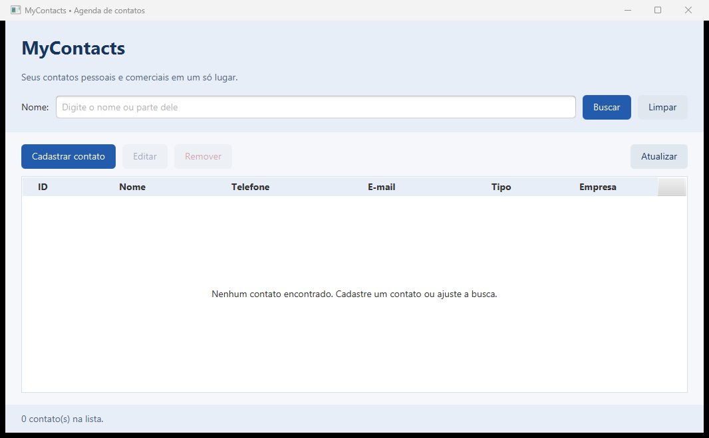

# Revisão do MyContacts e preparação para IntelliJ IDEA

Este relatório registra a revisão técnica local de **29/10/2026**, anterior à publicação dos ajustes. Naquela etapa não foram feitos commits, push, merge ou publicação.

## Estado inicial e estrutura

- Repositório Git existente, inicialmente limpo (`git status --short` sem saída), em `ae4a4f6`. Não foi inicializado outro repositório. Não foram encontrados arquivos `AGENTS.md` no projeto nem nos diretórios ancestrais consultados. Foram lidos o README, o POM e o registro da entrega anterior antes das alterações.
- Projeto **Maven**, versão da aplicação **2.0.0**, com layout `src/main/java`, `src/main/resources` e `src/test/java`; compilação com `maven.compiler.release=17`, UTF-8 e sem `module-info.java`.
- Dependências: JavaFX Controls/FXML **17.0.21**, SQLite JDBC **3.53.4.0** e JUnit Jupiter **5.14.2**. Plugins e dependências existentes foram preservados.
- Entradas: `br.com.igor.mycontacts.app.AgendaApp` (JavaFX) e `br.com.igor.mycontacts.app.Main` (console).
- Já existem interface gráfica, CRUD, Generics, JDBC e testes: esta pasta **não está apenas na etapa console**, apesar do nome do diretório e do artefato Maven.

## Problemas encontrados e ajustes

| Achado | Ajuste realizado |
| --- | --- |
| Ausência de instruções de importação, JDK e execução no IntelliJ e de configurações compartilhadas. | README com procedimento de abertura como Maven, SDK/linguagem, JDK do importador/runner, pastas de fontes/recursos e execução/testes. Quatro configurações portáveis em `.run/`. |
| `java`, `javac` e `mvn` indisponíveis no PATH deste terminal. | Usadas as ferramentas já instaladas com o IntelliJ para verificar o projeto. Documentada a distinção entre Maven pela IDE e comandos no terminal; nenhuma configuração global do Windows foi alterada. |
| Configuração local do VS Code e scripts de registro de ferramentas de uma extensão de modernização Java. | Removidos os quatro arquivos relacionados abaixo, após leitura e busca de referências. Não continham classpath, argumentos, variáveis ou passos necessários ao projeto. |
| Caminhos absolutos de instalações locais no README e no registro anterior. | Substituídos por instruções de seleção do JDK/ferramentas e variáveis de ambiente. Código e POM já usavam caminhos portáveis e foram preservados. |
| `.gitignore` não cobria `*.code-workspace` e saída `out/` da IDE. | Incluídos esses padrões; mantidas as exclusões de `.idea/`, `*.iml`, Maven, SQLite e dados pessoais. As configurações compartilhadas `.run/` permanecem visíveis ao Git. |
| Resultados anteriores e ZIP antigo poderiam ser confundidos com a revisão atual. | Separados registros históricos de testes desta sessão; README identifica o ZIP existente como anterior aos ajustes e orienta incluir `.run/` na próxima entrega. |

Não foi confirmada falha funcional que justificasse modificar código Java, FXML, CSS ou o POM. Foram revisados os fluxos de validação e duplicidade em `Agenda`, a edição por ID, os controllers, o tratamento de fim de entrada e erros no console, o fechamento dos recursos JDBC e a preservação das causas técnicas em `PersistenciaException`. Os testes e a execução do console deram evidências para esses comportamentos; não constituem prova de ausência de todo defeito possível.

### Arquivos removidos

1. `.vscode/settings.json`: continha somente `java.configuration.updateBuildConfiguration=interactive`, preferência do editor.
2. `.github/modernize/java-upgrade/hooks/scripts/recordToolUse.ps1`.
3. `.github/modernize/java-upgrade/hooks/scripts/recordToolUse.sh`.
4. `.github/modernize/java-upgrade/.gitignore`: ignorava os artefatos locais dessa extensão.

Os scripts apenas registravam chamadas `run_in_terminal`/`appmod-*` para a extensão; não eram usados pelo Maven nem pelo código. Todos esses arquivos já eram ignorados pelo Git, portanto sua remoção física não aparece como exclusão de arquivos versionados no diff. As pastas ficaram vazias e foram removidas. Não foram encontrados arquivos `*.code-workspace` nem outras tarefas ou configurações de depuração desse editor.

As imagens antigas do console foram inspecionadas: mostram a saída da aplicação, sem controles ou instruções exclusivas do VS Code. Foram mantidas, assim como código, testes, dependências, recursos, imagens e dados preexistentes. O ZIP antigo foi preservado. Nenhum arquivo foi excluído por ter sido criado pelo Codex.

## IntelliJ: configurações e verificação efetiva

Foram adicionados e reconhecidos no seletor de execução:

| Arquivo | Configuração | Comportamento |
| --- | --- | --- |
| [MyContacts-JavaFX.run.xml](../.run/MyContacts-JavaFX.run.xml) | MyContacts - JavaFX | Maven `compile javafx:run`; usa `AgendaApp` definida no POM. |
| [MyContacts-Console.run.xml](../.run/MyContacts-Console.run.xml) | MyContacts - Console | Application com `Main`, classpath do módulo e entrada na janela Run. |
| [MyContacts-Testes.run.xml](../.run/MyContacts-Testes.run.xml) | MyContacts - Testes | Maven `test`, sem perfil gráfico. |
| [MyContacts-Verificar-interface.run.xml](../.run/MyContacts-Verificar-interface.run.xml) | MyContacts - Verificar interface | Maven `verify`, com `verificar-interface` ativo. |

As quatro configurações usam `$PROJECT_DIR$`, sem caminho absoluto de SDK, Maven, repositório de dependências ou banco. Elas herdam a seleção local de JDK/Maven. `.idea/` continua sendo configuração local ignorada.

Na IDE conectada, foram consultados o módulo Java `mycontacts-java-console`, as bibliotecas JavaFX/SQLite/JUnit e os pontos de execução JUnit. O build completo da IDE (`rebuild`) terminou com `isSuccess=true` e nenhuma ocorrência em `problems`. O `Main.class` recompilado tem versão de bytecode **61**, correspondente ao alvo Java 17. O carregamento de ambos os FXML e do CSS, os testes nativos e a abertura real de `AgendaApp` confirmaram que fontes, testes e recursos estavam disponíveis nas execuções da IDE.

O ambiente desta sessão foi **Windows 11 amd64**, IntelliJ IDEA **2026.2.3**, **JBR 25.0.4** com compilador e **Maven 3.9.16** incluídos na instalação da IDE. A configuração local do projeto tinha nível de linguagem 17 e SDK `jbr-25`. Não foi alterada a instalação global de Java ou Maven.

### Testes e execuções desta sessão

| Onde | Ação | Resultado observado |
| --- | --- | --- |
| Terminal externo à IDE | Maven `-Dmaven.repo.local=.maven-repository -o -B test`, usando Java/Maven da instalação existente. | **44 testes**, sem falhas, erros ou ignorados; `BUILD SUCCESS`. |
| IntelliJ, build nativo | Build e depois rebuild completo do módulo. | Ambos passaram; nenhum problema de compilação retornado. |
| IntelliJ, runner JUnit nativo | Classe `InterfaceIT`. | Quatro testes iniciados/concluídos, sem evento de falha; processo com **exit code 0**. |
| IntelliJ, configuração compartilhada | **MyContacts - Verificar interface** (`verify` com perfil gráfico). | **48 testes**, 0 falhas, 0 erros, 0 ignorados; `BUILD SUCCESS`; gerado `target/mycontacts-java-console-2.0.0.jar`. |
| IntelliJ, configuração compartilhada | **MyContacts - Testes**, após rebuild. | **44 testes**, 0 falhas, 0 erros, 0 ignorados; `BUILD SUCCESS`, exit code 0. |
| IntelliJ, aplicação real | **MyContacts - JavaFX**. | Janela MyContacts aberta com CSS, tabela e botões; captura acima; fechada normalmente, seguida de `BUILD SUCCESS` no Maven. |
| IntelliJ, runner Application nativo | `Main`, por configuração temporária equivalente à compartilhada, acrescentando banco de teste e entrada redirecionada `2`/`5`. | Listou os dois contatos fictícios persistidos pelo teste do terminal e encerrou com **exit code 0**. Não foi simulado um CRUD completo por digitação na janela Run. A configuração temporária foi removida. |
| Terminal, cinco novos processos Java | Roteiro de console com SQLite em arquivo exclusivo dentro de `target/revisao-intellij-20261029/`. | Passaram cadastro comum/comercial; listagem vazia/preenchida; busca parcial/sem resultado; edição e remoção por ID; confirmação/cancelamento; duplicidade; nome/telefone vazios; e-mail inválido; ID inválido/inexistente; EOF durante cadastro; persistência após reabrir. |
| Terminal, lançamento Maven do console | `-Dmycontacts.db=... compile exec:java` com o banco fictício anterior e entrada `2`/`5`. | Propriedade de banco respeitada, contatos anteriores listados e `BUILD SUCCESS`, exit code 0. |

Os totais acima descrevem rodadas diferentes com casos repetidos. O projeto tem **48 casos no conjunto completo**, dos quais quatro são gráficos; os totais das rodadas não devem ser somados como testes distintos.

| Classe | Casos no conjunto completo | Falhas | Erros | Ignorados |
| --- | ---: | ---: | ---: | ---: |
| `AgendaTest` | 10 | 0 | 0 | 0 |
| `ContatoDAOTest` | 12 | 0 | 0 | 0 |
| `RepositorioTest` | 3 | 0 | 0 | 0 |
| `ValidadorEmailTest` | 19 | 0 | 0 | 0 |
| `InterfaceIT` | 4 | 0 | 0 | 0 |
| **Total** | **48** | **0** | **0** | **0** |

Evidências locais: `target/revisao-intellij-20261029/ide-verify.log`, `ide-testes.log`, `ide-javafx.log`, `ide-console.log`, `maven-console.log`, `console-1-crud.log` até `console-5-eof.log` e o roteiro `console-smoke.ps1`. Os XML JUnit ficam em `target/surefire-reports/`; consulte também o log de cada rodada, pois uma execução sem perfil gráfico não apaga necessariamente relatórios gráficos anteriores. Esses arquivos em `target/` são artefatos locais ignorados, não requisitos para executar o projeto.

Os testes automatizados gráficos acionaram controles JavaFX e confirmações reais, além de carregar os FXML. A abertura da aplicação principal foi uma verificação separada; não foi repetido nela todo o CRUD manual. Os dados do roteiro de console ficaram em um banco exclusivo de teste. Ao iniciar a aplicação principal, foi criado o banco padrão vazio `dados/contatos.db`, que não existia inicialmente e permanece ignorado pelo Git.

### Verificação antes da publicação

Após a autorização para publicar, ainda em **29/10/2026**, o README foi resumido e a configuração **MyContacts - Verificar interface** foi executada novamente pelo Maven integrado: **48 testes, 0 falhas, 0 erros e 0 ignorados**, `BUILD SUCCESS` e processo com código 0. Os XML JUnit confirmam `java.version=25.0.4`; foi utilizado o mesmo JBR 25.0.4 e Maven 3.9.16, sem execução local em JVM 17. O build da IDE também passou, sem problemas retornados.

Foram conferidos os quatro XML de execução, classes, módulo, objetivos Maven, diretórios relativos e perfil gráfico, além de **28 links locais**, incluindo âncoras Markdown, padrões do `.gitignore` e `git diff --check`. O log desta rodada está em `target/publicacao-intellij-20261029/ide-verify-publicacao.log`; logs, caches, bancos e ferramentas de verificação permanecem locais e fora dos commits.

## Comparação com o PDF, páginas 10 a 12

Fonte consultada: documento local **`upload-15750602774185142111.pdf`**, encontrado em Downloads, com 13 páginas e a seção **“Projeto 3: Agenda de Contatos (Versão Console)”**, nome MyContacts. Foram renderizadas e lidas as páginas físicas **10, 11 e 12**, cuja numeração impressa coincide. O anexo não estava acessível diretamente pela conversa; a comparação se refere a esse documento local com a seção correspondente. SHA-256: `EFD002FEA7E9B1814150089B6D2DD2D15A60DB754F9DAA7B95E93934838F8C63`.

| Requisito | Evidência encontrada | Situação |
| --- | --- | --- |
| Cadastro, listagem, busca e remoção da versão inicial; edição na evolução gráfica | `Main`, `Agenda`, controllers e DAO; `AgendaTest`, `ContatoDAOTest`, `InterfaceIT` e roteiro do console cobrem os cinco fluxos. | **atendido** |
| Repositório genérico para contatos comuns/comerciais e operações de busca/listagem/remoção | [Repositorio](../src/main/java/br/com/igor/mycontacts/repository/Repositorio.java) usa `T extends Identificavel`; `ContatoDAO implements Repositorio<Contato>`; `ContatoComercial extends Contato`; CRUD exercitado em `RepositorioTest`. | **atendido** |
| Curingas `?`, `? extends T`, `? super T` e método genérico | `quantidade(Collection<?>)`, `adicionarTodos(Collection<? extends T>, Collection<? super T>)`, `copiarPara` e `Predicate<? super T>`; uso em serviço/controller e testes com subtipos e `List<Object>`. | **atendido** |
| JavaFX: `AgendaApp extends Application`, `start(Stage)`, tela principal e formulário validado | [AgendaApp](../src/main/java/br/com/igor/mycontacts/app/AgendaApp.java), `AgendaController`, `ContatoFormController`; carregamento, cadastro, edição, seleção, busca e confirmação em quatro testes gráficos; aplicação aberta pela IDE. | **atendido** |
| Componentes e layouts: Label, TextField, Button, TableView, ComboBox, VBox, HBox, BorderPane e GridPane | Os dois [FXML](../src/main/resources/br/com/igor/mycontacts/view/) contêm esses controles/layouts; testes carregam ambos. | **atendido** |
| Manipulação de eventos com `setOnAction()` citada no PDF | Eventos funcionam por `onAction="#metodo"` no FXML e métodos `@FXML` nos controllers. Não há chamada literal a `setOnAction()`. Confirmar se o curso aceita essa forma declarativa equivalente; não é uma falha de execução. | **parcial** |
| FXML separado da lógica e estilização CSS | `agenda.fxml`, `contato-form.fxml` e `agenda.css`; controllers separados; CSS relativo `@../css/agenda.css`, recursos carregados nos testes e na aplicação. | **atendido** |
| Scene Builder usado para montar visualmente as telas | Registro de 28/10 e quatro capturas comprovam abertura e inspeção das telas/prévias no editor; o registro informa que os FXML não foram salvos novamente. Não comprova a montagem visual original. Não foi reaberto o Scene Builder nesta revisão. | **parcial** |
| SQLite ou MySQL, tabela `contatos` com ID, nome, telefone, e-mail e empresa anulável | [ContatoDAO](../src/main/java/br/com/igor/mycontacts/dao/ContatoDAO.java) cria esses campos em SQLite. Usa `TEXT` e `AUTOINCREMENT`, adequados ao banco escolhido, e campo adicional `tipo` para preservar comerciais com empresa vazia/nula. O esquema não é uma cópia literal do exemplo MySQL do PDF. | **atendido** |
| JDBC, `ContatoDAO`, conexão centralizada, CRUD com PreparedStatement/ResultSet e proteção contra SQL Injection | `Conexao` e `ContatoDAO`, parâmetros SQL e `try-with-resources`; 12 testes DAO cobrem CRUD, reabertura, tipos, texto com aspas/caracteres SQL e falhas com causa técnica preservada. | **atendido** |
| Separação da lógica da aplicação e da persistência (DAO) | `Agenda` recebe `Repositorio<Contato>`; DAO cuida de JDBC; modelo não importa JDBC nem JavaFX; controllers cuidam dos eventos. | **atendido** |
| Validação de e-mail com `ValidadorEmail` | [ValidadorEmail](../src/main/java/br/com/igor/mycontacts/utils/ValidadorEmail.java), reutilizado por `Agenda` e console; 19 casos válidos/inválidos, além de validação via botão no teste gráfico. Validação de formato, sem consulta à caixa postal. | **atendido** |
| JUnit: inserção, remoção, busca, validação, assertions e testes independentes/automatizados | `AgendaTest`, `ContatoDAOTest`, `RepositorioTest`, `ValidadorEmailTest`; anotações `@Test`, `@BeforeEach`, `@AfterEach` e assertions; conjunto completo passou na IDE. | **atendido** |
| Testes DAO com SQLite em memória | [BancoEmMemoriaTest](../src/test/java/br/com/igor/mycontacts/BancoEmMemoriaTest.java) cria URL exclusiva por teste, com `mode=memory&cache=shared` e conexão âncora; fecha em `@AfterEach`. Há também teste adicional de persistência em arquivo com `@TempDir`. | **atendido** |
| Tela de detalhes, indicada como opcional | Não há tela específica; tabela e formulário apresentam os dados. Por ser opcional, não impede a entrega intermediária. | **ausente** (opcional) |
| Continuidade da equipe e eventuais acordos de avaliação com professor/tutores | O código e os testes não comprovam essas instruções pedagógicas da página 12. | **não verificável** |

## Pendências e limites

1. A execução local foi feita no JBR **25.0.4**, com alvo/bytecode Java 17. Validar em uma **JVM 17** se essa for a versão exigida pelo curso. O relato externo anterior de Java 17 não foi tratado como teste desta sessão.
2. Documentar a montagem das telas no Scene Builder, se exigida na avaliação; os registros atuais demonstram somente a inspeção. Confirmar também a aceitação dos eventos declarativos em FXML em relação à menção literal a `setOnAction()`.
3. Gerar um novo ZIP quando for entregar os ajustes, incluindo `.run/`. O ZIP anterior não foi sobrescrito nem publicado nesta revisão.
4. Java e Maven continuam fora do PATH deste terminal; as configurações da IDE usam as instalações selecionadas no IntelliJ. As instruções do README explicam como executar em cada ambiente.

Avisos observados: JavaFX carregado pelo classpath no runner JUnit, uso de `sun.misc.Unsafe` pelo renderizador JavaFX 17 no JBR 25 e aviso de acesso nativo do SQLite no runner Application. Não impediram execução nem testes. A importação do IntelliJ foi verificada no ambiente já existente, com dependências em cache; não foi simulada uma máquina nova sem cache.

Não foi implementada uma nova evolução do projeto. Para um projeto que estivesse somente no console, faltariam interface JavaFX/FXML/CSS, repositório genérico/curingas, persistência JDBC/DAO e testes JUnit/SQLite em memória; neste repositório essas partes já estão presentes e foram verificadas conforme as evidências acima.
