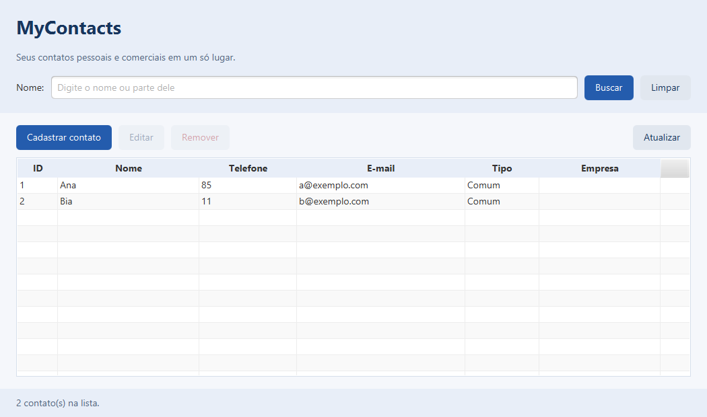
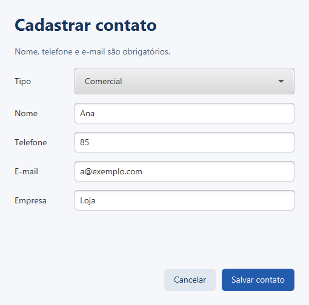
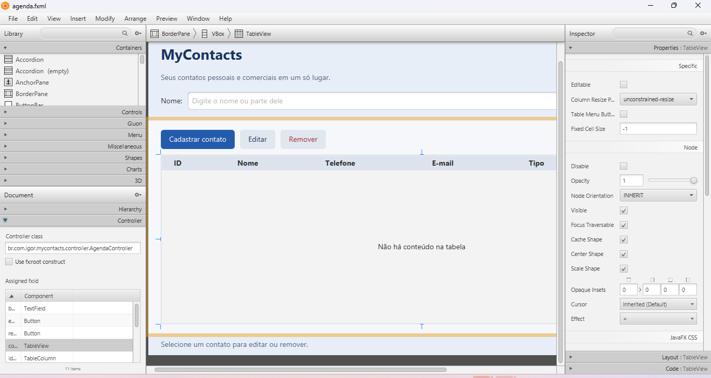
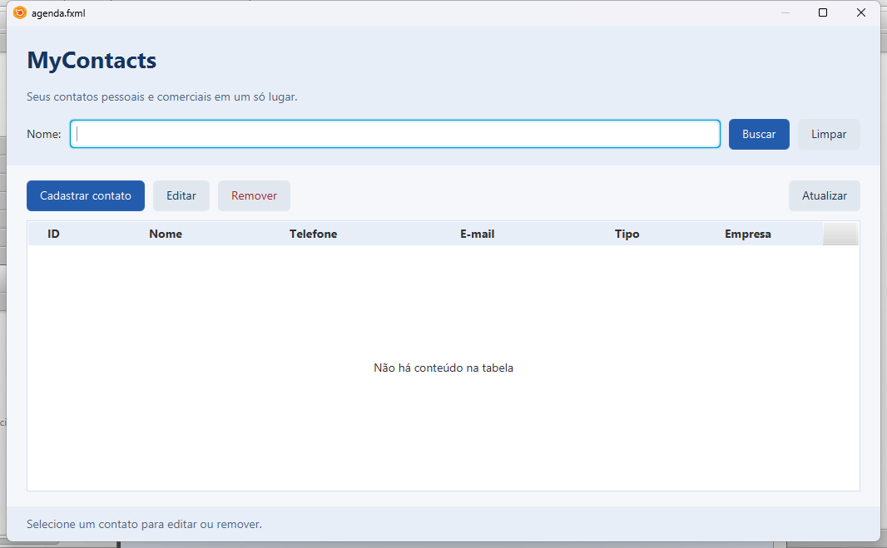
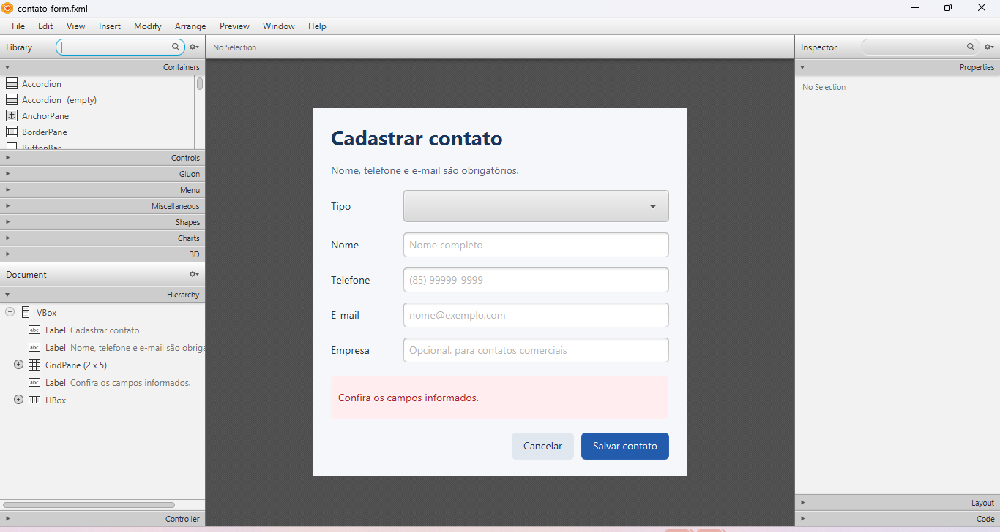
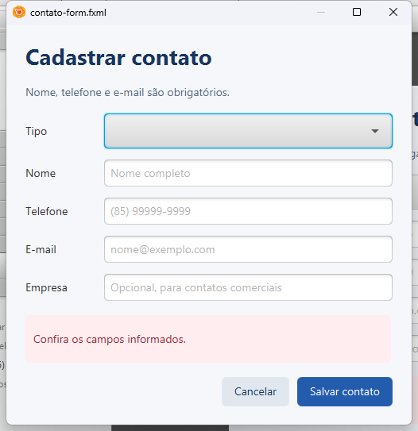

# Verificação da segunda entrega

Fechamento realizado em **28/10/2026**. Este registro separa as verificações executadas nesta máquina da revisão externa no Java 17 informada pelo responsável.

Este é um registro histórico. A preparação para IntelliJ, os resultados de 29/10/2026 e a comparação com as páginas 10–12 do PDF estão em [revisao-intellij.md](revisao-intellij.md).

## Origem das verificações

| Origem | Ambiente | O que foi verificado |
| --- | --- | --- |
| Esta máquina, nesta etapa | Windows 11 amd64, OpenJDK/JBR **25.0.4**, Maven **3.9.16**, JavaFX **17.0.21**, compilação `--release 17` | Reexecução dos 48 testes e geração do JAR; abertura dos dois FXML no Scene Builder 26.0.0; inspeção visual do editor e das prévias; conferência dos vínculos FXML/CSS/controllers; composição do ZIP. |
| Revisão externa, conforme relato do responsável | **Java 17** | Compilação, **48 testes aprovados** e persistência pelo console. Os quatro testes gráficos foram executados **em modo sem tela**. |

O alvo `--release 17` da compilação local é diferente da versão da JVM que executou os testes: nesta máquina foi utilizado o JBR 25.0.4. Não foi feita uma nova execução local no JDK 17, nem uma nova demonstração de persistência pelo console nesta etapa. A revisão externa não foi reexecutada por esta sessão, e não foram fornecidos seus relatórios brutos; os resultados externos acima têm como fonte o relato recebido.

## Testes executados nesta máquina

Java e Maven foram localizados na instalação do IntelliJ. Comandos utilizados:

```powershell
# Caminhos fornecidos pelo ambiente local, sem fixar a instalação de uma máquina:
# JAVA_HOME aponta para o JDK; mvn está no PATH.

& "$env:JAVA_HOME\bin\java.exe" -version
mvn -version
mvn '-Dmaven.repo.local=.maven-repository' -o -B -Pverificar-interface verify
git diff --check
```

O exemplo acima foi normalizado para evitar caminhos absolutos; a rodada original usou o Java e o Maven incluídos na instalação local do IntelliJ. O modo offline (`-o`) funcionou porque as dependências já estavam no cache local. Em uma máquina nova, omita `-o` para permitir o download das dependências. A saída Maven desta rodada foi preservada em `target/verificacao-local-final.log`; os XML JUnit em `target/surefire-reports/` foram consultados para confirmar os resultados e a JVM utilizada.

| Classe | Testes | Falhas | Erros | Ignorados |
| --- | ---: | ---: | ---: | ---: |
| `AgendaTest` | 10 | 0 | 0 | 0 |
| `ContatoDAOTest` | 12 | 0 | 0 | 0 |
| `RepositorioTest` | 3 | 0 | 0 | 0 |
| `ValidadorEmailTest` | 19 | 0 | 0 | 0 |
| `InterfaceIT` | 4 | 0 | 0 | 0 |
| **Total** | **48** | **0** | **0** | **0** |

**BUILD SUCCESS**, com geração de `target/mycontacts-java-console-1.0-SNAPSHOT.jar`. O conjunto sem o perfil de interface contém 44 casos; o perfil acrescenta quatro. Não foi utilizada a opção `clean` nesta rodada.

Os testes de interface carregam os FXML com `FXMLLoader`, aplicam CSS, criam janelas JavaFX e acionam os eventos dos botões. Cobrem busca e seleção, validação, cadastro comercial, edição por ID, cancelamento, duplicidade e exclusão. Também verificam que a mensagem de erro não desloca o botão Salvar para fora da cena. A inspeção visual no Scene Builder, descrita abaixo, foi uma ação separada desses testes automatizados.

As imagens seguintes foram geradas novamente nesta rodada pelos testes JavaFX e copiadas de `target/verificacao-ui/`. Os contatos são dados fictícios definidos nos testes.





Os avisos de `sun.misc.Unsafe` e de classes JavaFX carregadas pelo classpath no JBR 25 permaneceram, sem impedir os testes. Não foi verificada uma sessão interativa da aplicação no Java 17 nesta máquina.

## Conferência no Scene Builder

Não foi encontrado um executável do Scene Builder no `PATH`, nas pastas usuais de instalação, nos processos ou nos registros de desinstalação consultados antes da instalação. A biblioteca de integração do IntelliJ não foi tratada como uma instalação do editor.

Foi consultado o [site oficial da Gluon](https://gluonhq.com/products/scene-builder/), que direcionou ao [MSI do Scene Builder 26.0.0 para Windows](https://download2.gluonhq.com/scenebuilder/26.0.0/install/win/SceneBuilder-26.0.0.msi). O download ficou em `%TEMP%\mycontacts-scene-builder\SceneBuilder-26.0.0.msi`. A instalação por usuário concluiu com **código 0**, e foi confirmado o executável versão **26.0.0** em:

```text
%LOCALAPPDATA%\SceneBuilder\SceneBuilder.exe
```

Os dois arquivos foram abertos diretamente nesse executável. As janelas foram identificadas e operadas por automação do Windows; foram capturadas imagens do editor e de **Preview > Show Preview in Window (Ctrl+P)**. A prévia da agenda foi reposicionada para caber na tela. A área de edição tem rolagem porque é menor que o tamanho preferido da agenda; a prévia permite ver o layout inteiro.

| Arquivo | Conferência visual realizada | Resultado |
| --- | --- | --- |
| `agenda.fxml` | Cabeçalho, rótulo/campo de busca, Buscar, Limpar, Cadastrar contato, Editar, Remover, Atualizar, colunas ID/Nome/Telefone/E-mail/Tipo/Empresa e status inferior; cores, tipografia e espaçamentos. | CSS aplicado, controles legíveis e prévia inteira sem sobreposição ou corte dos botões nas dimensões preferidas. |
| `contato-form.fxml` | Tipo, Nome, Telefone, E-mail, Empresa, textos de orientação, área de erro, Cancelar e Salvar contato; alinhamento, espaçamentos e CSS. | Todos os campos e botões visíveis; área de erro reservada sem encobrir os botões. |

O Scene Builder não executa `initialize()` dos controllers da aplicação. Por isso, na prévia do formulário o combo Tipo está vazio, Empresa aparece habilitada e a mensagem de erro de exemplo fica visível. Na prévia da agenda, Editar/Remover não recebem o vínculo de desabilitação e a tabela usa o placeholder padrão. Esses estados são definidos pelos controllers durante a execução da aplicação; não foram classificados como defeitos do layout. Os comportamentos dinâmicos foram cobertos pelos testes locais.

### Agenda no editor

O painel Controller mostra `br.com.igor.mycontacts.controller.AgendaController` e a lista de 11 identificadores atribuídos. A parte direita do conteúdo pode ser vista pela rolagem do editor ou pela prévia abaixo.



### Prévia da agenda



### Formulário no editor



### Prévia do formulário



### Vínculos preservados

Além da conferência visual, os XML foram analisados e confrontados com os campos e métodos dos controllers. O recurso relativo `@../css/agenda.css` existe para ambas as telas. Nenhum FXML, CSS ou arquivo Java foi alterado nesta etapa, e os FXML não foram salvos novamente pelo editor.

| Arquivo | `fx:controller` | `fx:id` | Eventos `onAction` |
| --- | --- | --- | --- |
| `agenda.fxml` | `br.com.igor.mycontacts.controller.AgendaController` | `buscaField`, `editarButton`, `removerButton`, `contatosTable`, `idColumn`, `nomeColumn`, `telefoneColumn`, `emailColumn`, `tipoColumn`, `empresaColumn`, `statusLabel` | `#buscar` no campo e no botão, `#limparBusca`, `#cadastrar`, `#editar`, `#remover`, `#atualizar` |
| `contato-form.fxml` | `br.com.igor.mycontacts.controller.ContatoFormController` | `tituloLabel`, `tipoCombo`, `nomeField`, `telefoneField`, `emailField`, `empresaField`, `erroLabel` | `#cancelar`, `#salvar` |

**Resultado:** os dois arquivos abriram e foram conferidos no próprio Scene Builder. Não foram encontrados problemas que exigissem correções de layout, CSS ou ligações. O procedimento para repetir a inspeção está em **FXML e Scene Builder** no [README](../README.md#fxml-e-scene-builder).

## Evidências anteriores conservadas

`imagens/janela-funcionando.png` já existia antes deste fechamento e mostra uma demonstração anterior da aplicação nesta máquina com Ana Silva e Bruno Costa, contatos fictícios. Não é uma nova captura desta etapa nem uma evidência da revisão externa no Java 17. As imagens `demo-listagem-busca.png` e `demo-remocao-finalizacao.png` também são registros anteriores, da primeira entrega pelo console, identificados assim no README.

## Entrega

Arquivo gerado: **`entrega/mycontacts-segunda-entrega.zip`**.

O pacote usa uma lista explícita de inclusão: `src/`, `pom.xml`, `README.md`, `.gitignore` e `docs/`, incluindo todas as imagens deste registro. A raiz do ZIP contém diretamente o `pom.xml`, permitindo extrair e executar Maven nessa pasta.

Não inclui `.git/`, `target/`, `.maven-repository/`, outros caches de dependências, configurações locais de IDE, logs de execução, o instalador do Scene Builder ou bancos SQLite e auxiliares. O conteúdo é de código-fonte e documentação; não inclui dependências nem um executável autossuficiente. As entradas do ZIP, o conteúdo descompactado de cada entrada e os caminhos locais das imagens referenciadas foram conferidos após a geração.
